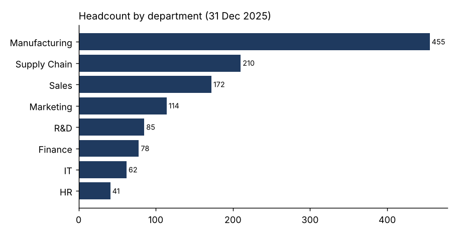
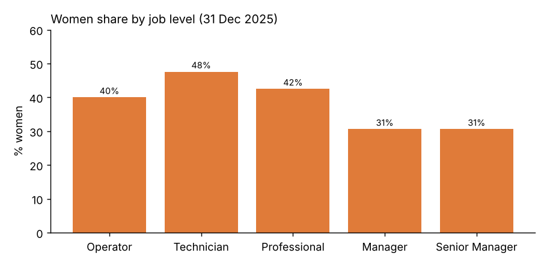
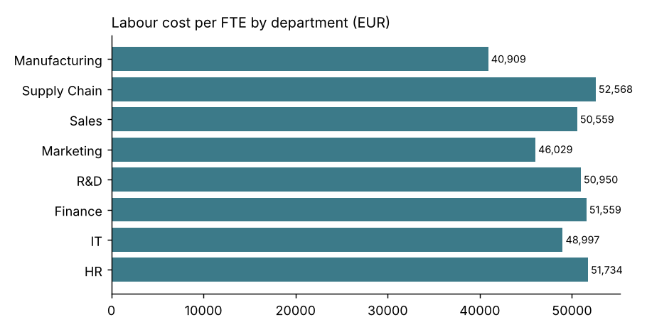

# People Analytics Dashboard

HR analytics and HR controlling reports for a consumer goods group with 1,470 employees in 4 countries: headcount and workforce structure, labour cost, attrition, and gender pay gap. The same KPIs are delivered three ways so they can be cross-checked: a Python pipeline, an Excel workbook with live formulas, and a Power BI report, plus a one-page user guide for self-service reporting.

Note: the data is simulated and anonymised (fixed random seed), so no real person is represented and every result can be reproduced.

## Main results (31 December 2025)

| KPI | Value |
|---|---|
| Headcount / FTE | 1,217 / 1,165.6 |
| Annual labour cost | 54.7 M EUR (46,925 EUR per FTE) |
| Attrition 2025 (2024) | 10.3% (9.4%), voluntary 4.8% |
| Women share | 41.5% overall, 30.6% at Manager and Senior Manager level |
| Gender pay gap | 2.7% unadjusted, 2.8% adjusted (same job level and country) |



Key insights for HR:
1. **Women are under-represented in management** (30.6% against 41.5% overall): the pay gap is driven by pay within the same level and country as much as by the mix, so both promotion and pay review deserve attention.
2. **Attrition went up from 9.4% to 10.3%** while headcount went down: worth a look by department before the year-end review.
3. **Manufacturing is the largest population but the lowest cost per FTE** (about 40,900 EUR), so headcount and labour cost must be read together in budget discussions.




## How it works

1. `data/generate_data.py` creates the employee file and injects a few realistic data issues (duplicates, missing department, negative salary, impossible FTE, country spelling).
2. `src/quality.py` runs the checks, fixes what can be fixed and sets aside what must be corrected at the source. Result: [reports/data_quality_report.md](reports/data_quality_report.md).
3. `src/kpis.py` computes the KPIs with documented HR definitions (headcount on a date, FTE, labour cost with employer charges, attrition on average headcount, unadjusted and adjusted pay gap) and hides groups under 5 people.
4. `src/build_excel.py` writes `excel/people_kpis.xlsx` with live formulas: COUNTIFS, SUMIFS, AVERAGEIFS and XLOOKUP (plus INDEX/MATCH for older Excel). The Excel figures match the Python ones.
5. `src/pipeline.py` runs everything and writes the CSV extracts and charts in `reports/`.
6. `powerbi/` contains the DAX measures and a step-by-step guide to build the 4-page report from `data/hr_employees_clean.csv`.

## Power BI report (4 pages)

1. Headcount and workforce structure (department, country, age band, contract)
2. Labour cost (total, per FTE, by department and country)
3. Attrition (rate, leavers by reason and department)
4. Gender pay gap and equity (average pay by gender and level, women share by level)

See [powerbi/dax_measures.md](powerbi/dax_measures.md) and [powerbi/BUILD_GUIDE.md](powerbi/BUILD_GUIDE.md).

## Confidentiality

Anonymous IDs, age in bands, aggregated views only and groups under 5 hidden. Details in [docs/confidentiality.md](docs/confidentiality.md). User guide: [docs/user_guide.md](docs/user_guide.md).

## How to run

```bash
pip install -r requirements.txt
python data/generate_data.py
python -m src.pipeline
python -m pytest -q          # 5 tests check the KPI definitions and quality checks on a tiny dataset with known answers
```

## Tech stack

Python (pandas), Excel (COUNTIFS, SUMIFS, AVERAGEIFS, XLOOKUP), Power BI (Power Query, DAX), pytest.
